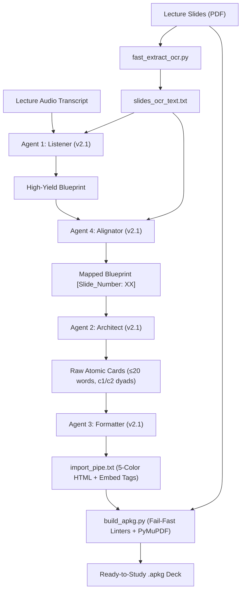

# LectureKing: Autonomous Medical School Anki Generator 👑

[](https://apps.ankiweb.net/)
[](https://www.python.org/)
[](LICENSE)
[](PIPELINE_SPECS.md)

**LectureKing (MlurqKing)** is an autonomous multi-agent AI pipeline designed to convert medical school lecture slides and audio transcripts into high-yield, exam-tested, SuperMemo-compliant Anki flashcards (`.apkg`) with embedded high-resolution 150 DPI slide captures.

Designed by a medical student for medical students, LectureKing eliminates 4+ hours of manual card creation per lecture while optimizing flashcards for rapid **5–8 second reflex recall**.

---

## ⚡ What's New in v2.1 (Transcript-Gated & Classmate-Refined)

The **v2.1 architecture** solves the two greatest flaws of traditional AI flashcard generators: **low-yield trivia bloat** and **paragraph-long reading fatigue**.

| Feature | Legacy Generators / v1 (OG) | LectureKing v2.1 (Current) |
| :--- | :--- | :--- |
| **Testability Filter** | Equal weight to slides & audio (creates cards on every unmentioned slide bullet) | **Transcript-Gated Filter**: Spoken transcript is the strict gatekeeper. Skipped slide bullets are dropped entirely. |
| **Review Speed** | 20–35 seconds per card (dense textbook paragraphs) | **5–8 seconds per card** (Rapid clinical reflex testing). |
| **Front Stem Length** | 25–40+ words with throat-clearing preambles | **Target 12–18 words** (Hard automated build-time linter ceiling of **≤ 20 words**). |
| **Cloze Structure** | Fragmented clozes & reverse-trivia testing | **The AnKing Gold Standard**: Mini-vignette stem clozing *only* the punchline (~85–90% single `c1`). |
| **Paired Clozes (`c1`/`c2`)** | Arbitrary or overused across unrelated facts | **Strict 10–15% Ceiling on Natural Dyads**: Reserved strictly for true reciprocal twins (e.g. 25°C mold vs 37°C yeast). Zero `c3`. |
| **Cloze Word Count** | Often clozes 8–15 word clauses | **Strict 1–4 Words Max per Cloze** (Fail-fast linter enforced). |
| **Color Coding** | Monochromatic white or over-padded color quotas | **Vibrant 5-Color Semantic Palette** (Anti-spoiler orange cloze, purple harmony back). |
| **Slide Visuals** | Missing or manual screenshot attachments | **Automated 150 DPI Page Extraction** dynamically injected into Back Extra. |

---

## 🎨 5-Color Semantic Coding Taxonomy

Front stems actively highlight key clinical entities to optimize scanning speed and visual retention:

1. <u><b><span style="color:#00FF00;">Primary Concept / Subject / Disease Entity</span></b></u> (`#00FF00` Green)
2. <span style="color:#FFA500;"><b>{{c1::Target Cloze Deletion}}</b></span> (`#FFA500` Orange — span tag placed strictly *outside* cloze brackets so the blank never reveals the answer)
3. <span style="color:#00FFFF;">Clinical Signs, Symptoms, Microscopic Hallmarks & Buzzwords</span> (`#00FFFF` Cyan)
4. <span style="color:#FFB6C1;">Anatomic Site / Organ / Tissue Structure</span> (`#FFB6C1` Light Pink)
5. <span style="color:#FFFF00;"><b>Key Demographic / Clinical Criterion / Lab Cutoff</b></span> (`#FFFF00` Yellow)

> **AnKing Purple Harmony**: The `Back Extra` field strictly avoids colored HTML spans to blend seamlessly with native AnKing dark-mode styling.

---

## 🛠️ The 4-Agent Pipeline Workflow



1. **Agent 1 (Listener)**: Filters slides against the lecture audio. Drops unmentioned slide bullets, highlights explicit professor exam cues, and flags high-yield clinical pivots.
2. **Agent 4 (Alignator)**: Maps every concept item chronologically to its verified slide number (`[Slide_Number: XX]`) using the slide OCR text.
3. **Agent 2 (Architect)**: Drafts atomic cards following SuperMemo rules and AnKing standards (12–18 word front stems, 1–4 word clozes, 2-part Back Extra with selective professor rationale anchor).
4. **Agent 3 (Formatter)**: Applies the 5-color HTML semantic palette, nests clozes, sanitizes LaTeX into clean HTML, and appends dynamic slide image tags (`_slide_XX.png">`).
5. **Compiler (`build_apkg.py`)**: Renders all slides at crisp 150 DPI, runs automated quality linters, and packages everything into an import-ready `.apkg` file.

---

## 🚀 Quickstart Guide

### 1. Prerequisites
- **Python 3.9+**
- **Anki Desktop**
- Any advanced LLM (Claude 3.5 Sonnet in Claude Projects, ChatGPT Plus, or Google Antigravity).

### 2. Installation
Clone the repository and install the lightweight Python dependencies:
```bash
git clone https://github.com/mlurq2/MlurqKing.git
cd MlurqKing
pip install -r requirements.txt
```

### 3. Step-by-Step Usage

#### Step A: Extract Slide Text
Place your lecture slides (`slides.pdf`) in the folder and run:
```bash
python fast_extract_ocr.py slides.pdf
```
*(Generates `slides_ocr_text.txt` in seconds).*

#### Step B: Run the Prompts in Claude / ChatGPT / Antigravity
1. Create a Project in Claude (or Custom GPT) and upload the files in `prompts/` and `PIPELINE_SPECS.md` as project knowledge.
2. Provide your `slides_ocr_text.txt` and `transcript.txt`.
3. Run the agents sequentially using `prompts/master_orchestrator.md`:
   - *"Please act as Agent 1 (Listener v2.1) with Professor [Name]..."*
   - Follow up with Agent 4 (Alignator), Agent 2 (Architect), and Agent 3 (Formatter).
4. Save the pipe-separated output (`Front | Back Extra`) to `import_pipe.txt`.

#### Step C: Build the `.apkg` Package
Run the compiler script with your slide PDF and pipe file:
```bash
python build_apkg.py --pdf "slides.pdf" --pipe "import_pipe.txt" --deck "Medical School::Pulmonology::Asthma & COPD [v2.1 LectureKing]" --output "Asthma_COPD_v2.1_LectureKing.apkg"
```

The compiler automatically:
- Extracts high-resolution 150 DPI slide images into the package.
- Audits every front stem against the **≤ 20 words reflex limit**.
- Audits every cloze against the **≤ 4 words cloze ceiling**.
- Audits front stems for **≥ 3 distinct semantic colors**.
- Bundles everything into `<Deck_Name>.apkg`.

Double-click the `.apkg` file to import directly into Anki!

---

## 📂 Repository Structure

```
MlurqKing/
├── prompts/
│   ├── agent_1_listener.md       # v2.1 Transcript-gated blueprint extractor
│   ├── agent_2_architect.md      # v2.1 AnKing vignette-to-punchline card architect
│   ├── agent_3_formatter.md      # v2.1 5-color semantic HTML engine
│   ├── agent_4_alignator.md      # v2.1 Slide number alignment engine
│   └── master_orchestrator.md    # Multi-agent orchestration prompt
├── build_apkg.py                 # Multi-linter Anki package compiler (PyMuPDF + genanki)
├── fast_extract_ocr.py           # Fast slide text extraction script
├── AGENTS.md                     # System rules and behavioral specifications
├── PIPELINE_SPECS.md             # Full architecture comparison (v1 vs v2 vs v2.1)
├── requirements.txt              # PyMuPDF and genanki dependencies
├── .gitignore                    # Prevents committing heavy PDFs, PNGs, and decks
└── README.md
```

---

## 📜 Specifications & Version Support

This repository supports three codified architectures detailed in [`PIPELINE_SPECS.md`](PIPELINE_SPECS.md):
- **v2.1 (Current / Recommended)**: Classmate-Refined & Transcript-Gated (5–8s reflex speed, ≤20 word stems, AnKing style).
- **v2**: Natural Clinician Baseline (Plain clinical English, organic density).
- **v1 (OG)**: Classic exhaustive slide-by-slide transcription (~2.5–4 cards/min).

---

## 👨‍⚕️ Author & Philosophy
Built by **Mustafa Lurq** ([@mlurq2](https://github.com/mlurq2)).  
*Medical school is a marathon of active recall. Stop spending 4 hours manually formatting cards, and start mastering high-yield clinical pivots.*
